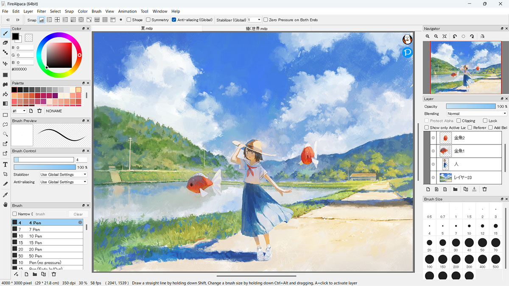
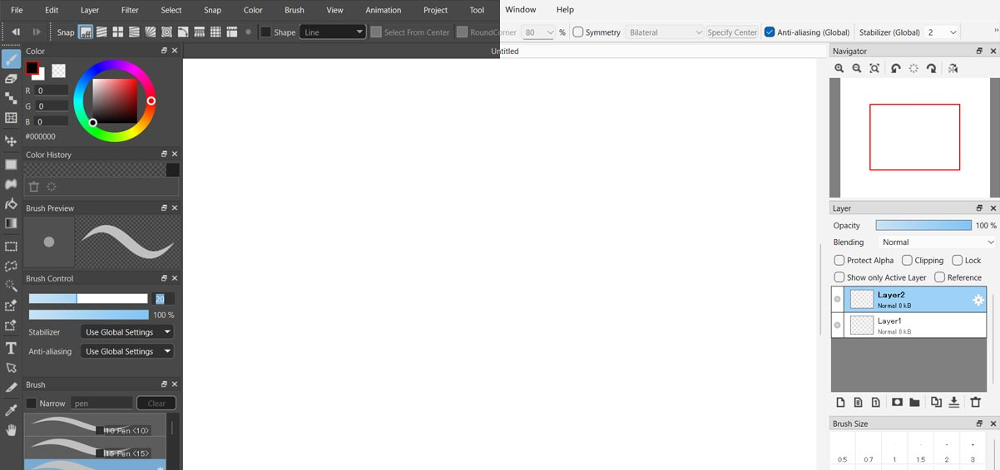

# FireAlpaca SE: Color Studies That Become Stories

FireAlpaca SE brings painting and frame animation to a focused desktop workspace.
Use this guide to develop a brush study, carry its colors into a sequence, and review the finished images.

[](https://firealpaca-se.github.io/FireAlpaca-SE/)

## A brush test worth keeping

A useful test answers a drawing question: can this brush describe the edge, texture, or shadow you need?
Choose one subject, such as a folded sleeve, and keep the canvas size constant while comparing settings.
Save the study separately so experiments remain easy to revisit.

FireAlpaca SE 3 introduces a multicore brush engine with Circle, Material, and SVG Path brush tips.
Its brush synthesis can combine three strokes, with clipping and masking options.
Test one component first, then add the others when their contribution is visible.

### Give each mark a job

- Use a narrow stroke for contours that must survive a reduced preview.
- Try a broader mark for the shadow mass before adding texture.
- Compare a dry edge and a soft transition on the same shape.
- Repeat a stroke slowly and quickly to reveal changes in spacing.
- Keep one untouched sample beside every revised version.

MyPaint cursor assets offer compact references for illustrating tool roles in accompanying notes:

- [cursor_pencil.png](pixmaps/cursor_pencil.png) represents the pencil cursor asset.
- [cursor_eraser.png](pixmaps/cursor_eraser.png) provides an eraser cursor reference.
- [cursor_colorize.png](pixmaps/cursor_colorize.png) supplies the colorize cursor artwork.

A cursor illustration can label a tutorial step; the actual stroke sample demonstrates the result.



### Keep the comparison fair

Record the canvas dimensions, zoom, brush size, and drawing device beside the samples.
Judge edges at full size and at the size readers will actually see.
If a texture disappears in the small view, simplify it before increasing detail.

## Build a palette around the subject

Start with the lightest light, the darkest dark, and a middle value that connects them.
A limited palette makes it easier to notice whether lighting or local color is carrying the picture.
Keep a neutral background visible while choosing saturated accents.

### Three compact color shelves

Use the following GIMP Palette files as RGB references for a warm, cool, or restrained study.
The descriptive names help organize comparisons without requiring a large swatch collection.

**Light and temperature**

- [Warm_Colors.gpl](palettes/Warm_Colors.gpl) collects warm color entries.
- [Cool_Colors.gpl](palettes/Cool_Colors.gpl) offers a contrasting cool selection.
- [Pastels.gpl](palettes/Pastels.gpl) supplies pale colors for softer studies.
- [Watercolor.gpl](palettes/Watercolor.gpl) contains named RGB swatches, rather than brush settings.
- [Muted.gpl](palettes/Muted.gpl) provides quieter alternatives for backgrounds.

**Value and material**

- [Greys16.gpl](palettes/Greys16.gpl) gives sixteen evenly stepped grayscale entries.
- [Classic_4.gpl](palettes/Classic_4.gpl) offers a small traditional painting reference.
- [Browns_And_Yellows.gpl](palettes/Browns_And_Yellows.gpl) groups earth-colored choices.
- [Reds_And_Purples.gpl](palettes/Reds_And_Purples.gpl) groups red and purple entries.
- [MyPaint_Default.gpl](palettes/MyPaint_Default.gpl) provides the MyPaint default palette reference.

For example, use one dark blue, a warm midtone, and a pale neutral for an evening scene.
Paint a simple sphere with those colors before applying them to a complicated subject.

### A tiny palette you can read

This original GIMP Palette example records three RGB choices for compatible palette tools.
Enter the RGB values manually in FireAlpaca when reproducing the study; native GPL import is not assumed.

```text
GIMP Palette
Name: Evening Study
Columns: 3
#
32 41 64 Night
196 111 72 Warm light
235 220 190 Paper
```

The three numeric columns are red, green, and blue values from 0 to 255.
The text after them labels the swatch.
The GPL extension here denotes a palette format; licensing information belongs to separate documents.

## Separate the painted surface from its corrections

Keep broad color, line work, and finishing adjustments on layers with clear names.
Before editing a delicate area, save a revision that you can reopen independently.
A flattened preview is useful for review, while the layered document remains the working master.

FireAlpaca SE 3 includes layer masks for hiding selected portions of a layer.
Use a mask when a boundary needs repeated refinement.
Liquify offers local deformation tools, including push, expansion, contraction, and rotation.

### Match the correction to the problem

| What looks wrong | First experiment | Detail to inspect afterward |
| --- | --- | --- |
| An outline competes with the focal point | Reduce its visual weight on a separate layer | Readability at thumbnail size |
| A shadow has the right color but a harsh boundary | Refine the visible boundary with a mask | Halos along the silhouette |
| A small contour needs reshaping | Test a local Liquify adjustment on a saved revision | Nearby straight lines |
| Texture overwhelms the form | Reduce the texture contribution | Whether the main light direction still reads |
| An accent shifts the whole palette | Compare it against a neutral surround | Relative saturation and value |

These MyPaint interface resources can accompany diagrams about layers and protected painting regions:

- [layers.png](pixmaps/layers.png) provides layer-related interface artwork.
- [layer_duplicate.png](pixmaps/layer_duplicate.png) supplies a duplication icon reference.
- [cursor_alpha_lock.png](pixmaps/cursor_alpha_lock.png) illustrates an alpha-lock cursor concept.

Treat a thumbnail review as a composition check, then return to full size for edge cleanup.
Save the working document before producing each review image.

## Let a repeated color carry the sequence

A recurring accent can connect separate panels even when framing and lighting change.
Pick one object whose color remains recognizable throughout the sequence.
Check that the accent still works in the brightest and darkest panels.

FireAlpaca SE 3 projects group related files for work such as multipage illustrations and manga.
Keep page order explicit in your own naming, for example `scene-01`, `scene-02`, and `scene-03`.
A project group helps organize the work; the exported review sheet serves a different viewing purpose.



### Broader swatch collections

These palettes provide additional comparison sets for interface accents, backgrounds, and repeated colors:

- [Tango_Palette.gpl](palettes/Tango_Palette.gpl) offers the Tango palette collection.
- [Gnome_Palette.gpl](palettes/Gnome_Palette.gpl) supplies GNOME palette entries.
- [Ubuntu.gpl](palettes/Ubuntu.gpl) contains the Ubuntu palette reference.
- [Zenburn.gpl](palettes/Zenburn.gpl) offers a subdued named palette.
- [Visibone.gpl](palettes/Visibone.gpl) provides a Visibone color collection.
- [Visibone_2.gpl](palettes/Visibone_2.gpl) supplies the alternate Visibone collection.
- [GIMP_Default.gpl](palettes/GIMP_Default.gpl) contains the GIMP default swatch set.
- [Creative_Commons.gpl](palettes/Creative_Commons.gpl) provides another named color reference.
- [All_color_choice.gpl](palettes/All_color_choice.gpl) offers a broader set for comparison.

Palette names describe the collections, not a guarantee of color-managed output on another display.

### Review the panels together

Prepare separate PNG previews in a `panels` directory and choose an unused output filename.
With ImageMagick 7 available, this command builds a four-column contact sheet:

```sh
magick montage -label "%f" "panels/*.png" -tile 4x -geometry 180x180+8+8 "panel-review.png"
```

The reduced tiles expose changes in framing, value, and repeated color.
Keep the full-resolution originals for detailed inspection.

## Give the movement a readable pause

FireAlpaca supports onion-skin viewing to compare adjacent animation drawings.
SE provides GIF and APNG export for sharing animation.
Check the installed release and export dialog before committing to a delivery format.

Block the strongest poses first.
Add the transition drawings only after the action reads without them.
A short hold can clarify an expression more effectively than several extra in-between drawings.

### Watch the loop boundary

1. Compare the last pose with the first before polishing intermediate frames.
2. Inspect the silhouette with small details hidden.
3. Keep the canvas dimensions consistent across exported frames.
4. Check motion at its intended timing rather than stepping through frames alone.
5. Review transparency against both a light and a dark background.

### A video preview from existing PNG frames

For a separate review video, prepare opaque, equally sized PNGs named `frame-001.png`, `frame-002.png`, and onward.
Use even pixel dimensions for this H.264 example and an FFmpeg build with libx264.
The input rate below interprets the sequence as twelve frames per second.

```sh
ffmpeg -n -framerate 12 -start_number 1 -i "frames/frame-%03d.png" -c:v libx264 -pix_fmt yuv420p "motion-preview.mp4"
```

The `-n` option prevents replacing an existing output file.
MP4 here is an opaque viewing copy; retain the editable animation and any transparency-bearing export.
This example begins with existing numbered PNGs and does not assume an automatic SE sequence-export command.

## Keep a useful record of the session

Write down the application version, operating system, canvas dimensions, brush, and steps needed to reproduce a problem.
Attach a small drawing that demonstrates the behavior instead of an entire unrelated project.
For slow painting, compare the same stroke at the same zoom before changing several settings together.

MyPaint color-picker and navigation resources can label a report or an illustrated walkthrough:

- [cursor_color_picker.png](pixmaps/cursor_color_picker.png) provides a color-picker cursor asset.
- [cursor_color_picker_h.png](pixmaps/cursor_color_picker_h.png) supplies the hue-picker cursor variant.
- [cursor_hand_open.png](pixmaps/cursor_hand_open.png) offers a canvas-navigation cursor reference.

For a deeper color study, [spectral.md](doc/spectral/spectral.md) discusses spectral mixing research.
Its companion [rgb_to_spectral.py](doc/spectral/rgb_to_spectral.py) contains research code with external dependencies.
Use those materials to explore color models without treating them as documentation of the SE brush engine.

The [official SE page](https://firealpaca.com/fase/) describes the current feature set.
The [Steam listing](https://store.steampowered.com/app/458750/FireAlpaca_SE/) provides the commercial edition's platform and release information.

## Related Search Terms

FireAlpaca SE, FireAlpaca SE, firealpaca se 3, firealpaca se steam, firealpaca se painting software, painting, drawing, art, graphics-tablet, brushes, creative, animation, graphics2d, cartoon, onion-skin
